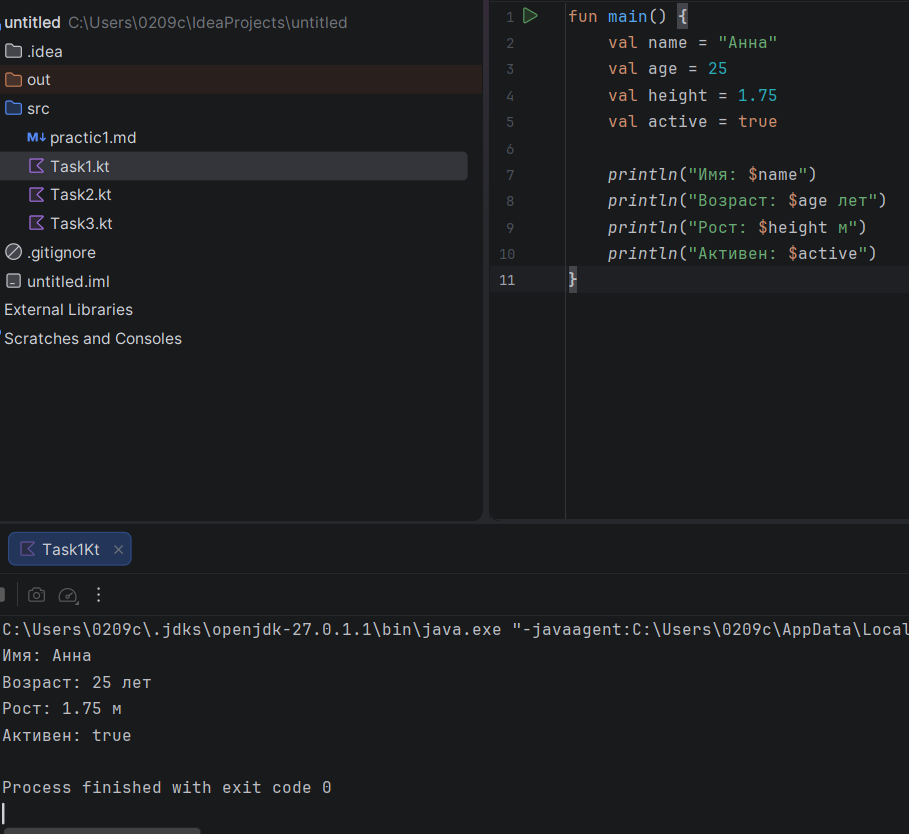
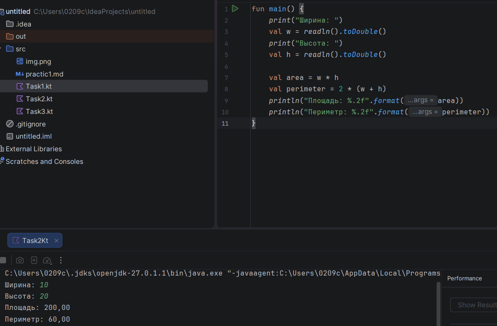
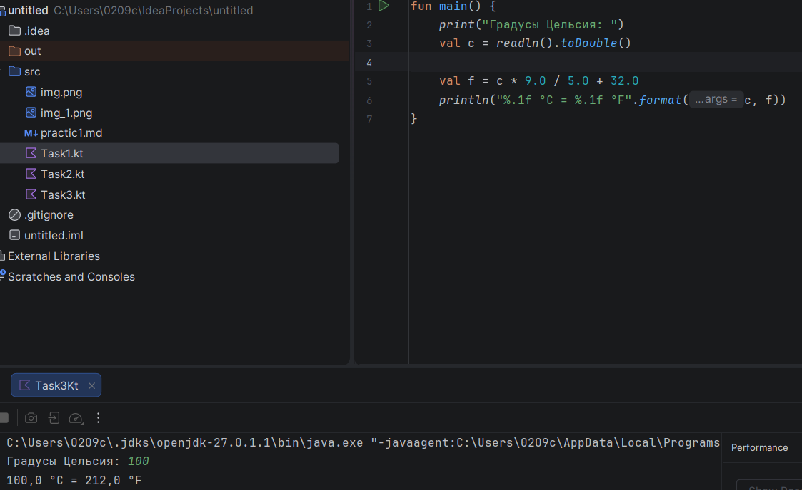
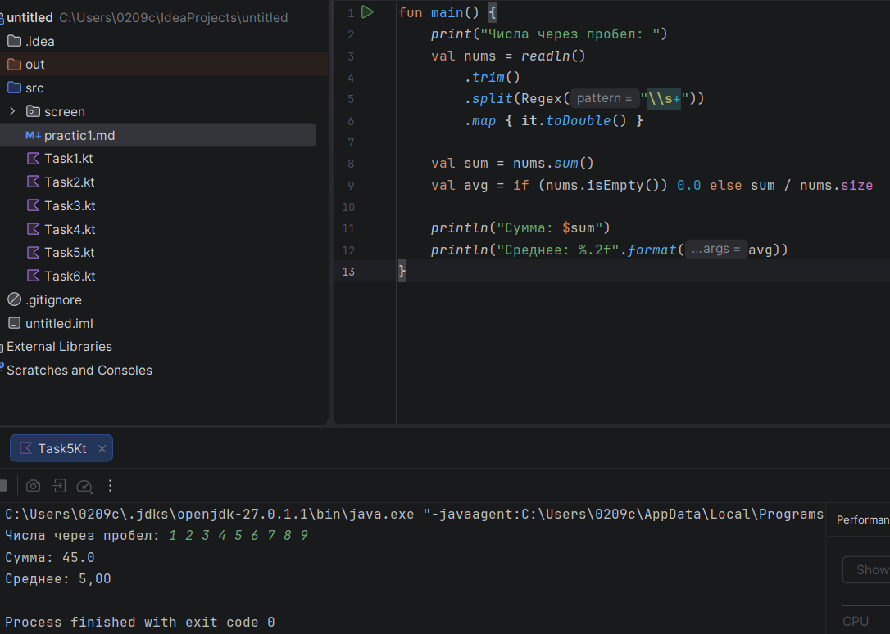
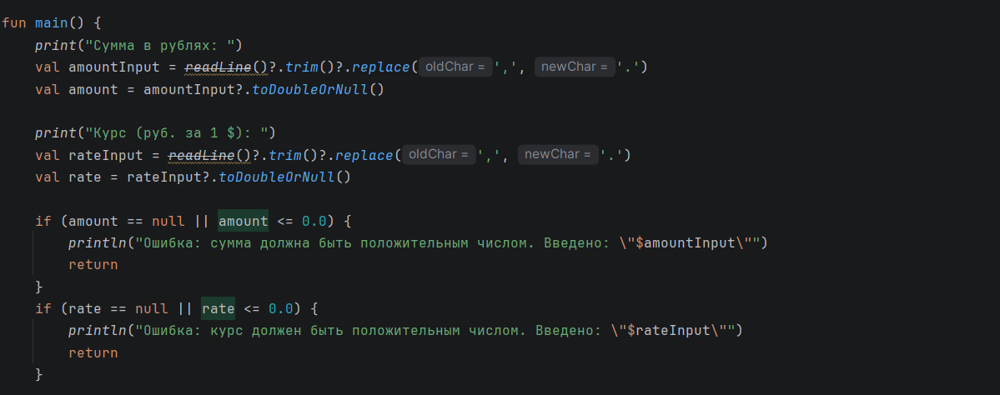

Задание 1.
```
Задача:

Объявите:
имя (String)
возраст (Int)
рост в метрах (Double)
активен ли аккаунт (Boolean)
```


Задание 2.
```
Задача:

Прочитайте ширину и высоту,
выведите площадь и периметр с двумя знаками после запятой.
```


Задание 3.
```
Задача:

Введите температуру в °C,
выведите в °F по формуле F = C * 9/5 + 32.
Используйте целочисленное деление аккуратно.
```


Задание 4.
```
Задача:

Спросить возраст,
вывести «Вы совершеннолетний» / «Ещё нет» / «Некорректный ввод».
```


Задание 5.
```
Задача:

Пользователь вводит числа через пробел. Выведите их сумму и среднее.
```


Задание 6.
```
Задача:

Даны название товара и цена.
Выведите чек шириной 30 символов с точками между названием и ценой.
```


Задача 7.
```
Задача:

Пользователь вводит сумму в рублях и курс доллара (сколько рублей за 1 $).
Программа считает сумму в долларах, удерживает фиксированную комиссию 1.5 % и выводит результат с двумя знаками после запятой.
Некорректный ввод — понятное сообщение, без падения.
```


